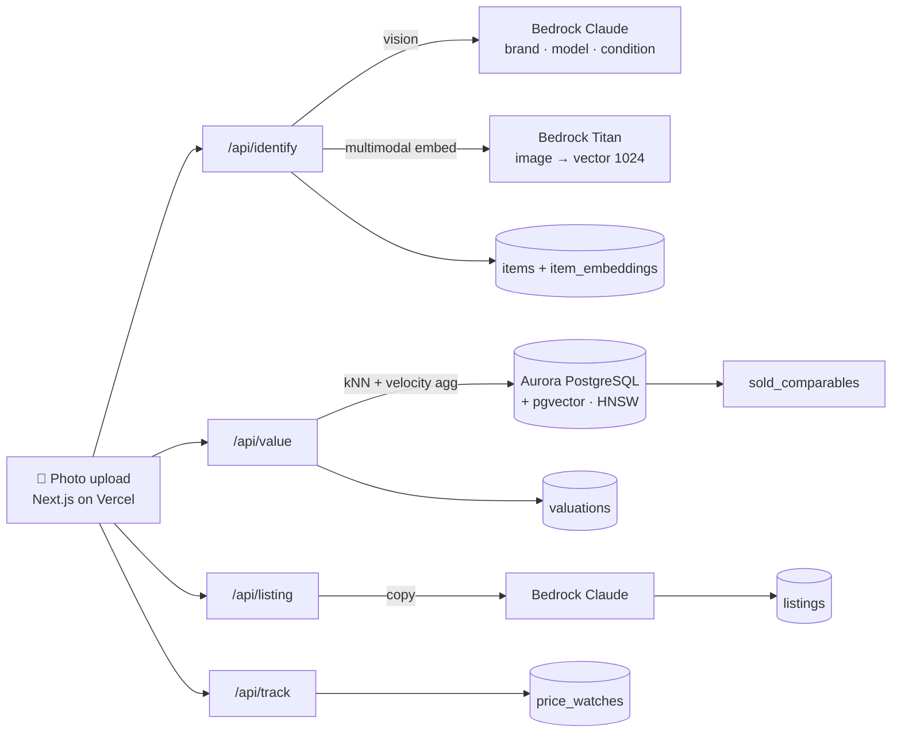

# ResaleRadar

**Snap a photo of anything you want to sell → get its market value across eBay, Poshmark, and Depop, how fast it'll sell, and a listing priced to move.**

[](https://resaleradar.vercel.app)
&nbsp;[](./DECK.pdf)


Built for the AWS × Vercel hackathon (Track 1, B2C) on **Amazon Aurora PostgreSQL + pgvector**, with **Amazon Bedrock** for vision, multimodal embeddings, and listing copy — deployed on **Vercel**.

> 🟢 **Live:** https://resaleradar.vercel.app &nbsp;·&nbsp; 📊 **Pitch deck:** [DECK.pdf](./DECK.pdf)

---

## What makes it different

1. **Genuine visual similarity.** Your photo is embedded with **Amazon Titan Multimodal Embeddings** (image + text in one 1024-dim space) and matched against sold comparables via **pgvector**. Two photos of the same sneaker match even when their titles don't — that's a real pgvector use case, not text search wearing a vector costume.
2. **Days-to-sell, not just price.** The highest median price is often the *slowest* to sell — and a listing that never sells is worth $0/day. ResaleRadar ranks platforms by expected **$/day (velocity)**, combining relational `sold_date`/`listed_date` math with vector nearest-neighbors in **one Aurora query**.
3. **Honest data framing.** eBay values represent data from eBay's official API (`source = 'ebay_api'`). Poshmark/Depop have no open sold-data API, so those are **estimated from comparable eBay sold data** and labeled as such everywhere in the UI.

## The core query (`lib/valuation.ts`)

```sql
SELECT platform,
       COUNT(*) AS comparables,
       MIN(sold_price) AS low,
       PERCENTILE_CONT(0.5) WITHIN GROUP (ORDER BY sold_price) AS median,
       MAX(sold_price) AS high,
       AVG(EXTRACT(epoch FROM (sold_date - listed_date)) / 86400) AS avg_days_to_sell
FROM (
  SELECT platform, source, sold_price, sold_date, listed_date
  FROM sold_comparables
  WHERE category = $1
  ORDER BY embedding <=> $2::vector   -- cosine distance to the scanned PHOTO
  LIMIT 20
) nearest
GROUP BY platform;
```

Vector similarity + relational aggregation in a single statement — the dual-capability story Aurora is rewarded for.

## Architecture



```
Photo ─▶ /api/identify ─▶ Bedrock (Claude vision)      ─▶ items
                       └▶ Bedrock (Titan multimodal)   ─▶ item_embeddings (vector 1024)
      ─▶ /api/value    ─▶ pgvector kNN + velocity agg   ─▶ valuations
      ─▶ /api/listing  ─▶ Bedrock (Claude)              ─▶ listings
      ─▶ /api/track                                     ─▶ price_watches
```

| Route | Does |
|---|---|
| `POST /api/identify` | photo → brand/model/condition → multimodal embedding → store item |
| `POST /api/value` | stored embedding → pgvector comparable search + velocity valuation |
| `POST /api/listing` | valuation → optimized, velocity-priced listing |
| `POST /api/track` | add item to the price watchlist |

Every server fetcher falls back to mock data (`lib/data.ts`) when Aurora/Bedrock aren't configured, so the UI always renders for a demo.

## Setup

```bash
npm install
cp .env.example .env.local      # fill in Aurora + Bedrock (see comments)

# With the Vercel Aurora integration:
vercel env pull .env.local

npm run db:schema               # create tables, enable pgvector, vector(1024)
npm run db:seed                 # embed + load sold_comparables
npm run dev
```

`npm run db:reset` re-applies the schema and re-seeds.

## Stack

- **Next.js 16** (App Router) on **Vercel**
- **Amazon Aurora PostgreSQL** + **pgvector** (HNSW cosine index)
- **Amazon Bedrock** — Claude (vision + copy), Titan Multimodal Embeddings (1024-dim)
- Credential-less DB auth via the **Vercel OIDC ↔ AWS IAM** federation (`@aws-sdk/rds-signer`)

## Monetization

Free (5 scans/mo) · Pro $9/mo (unlimited + cross-platform + auto-listing + alerts) · Business $29/mo (bulk, API, inventory) · 1% on cross-posted sales. The resale market is $250B+ growing 15%/yr.
